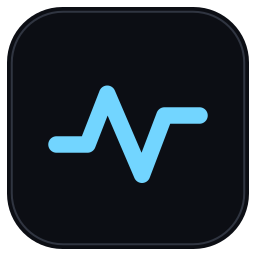
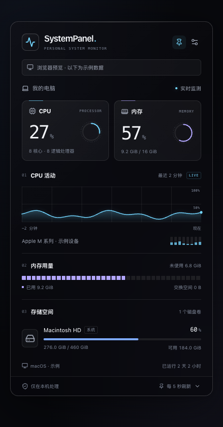
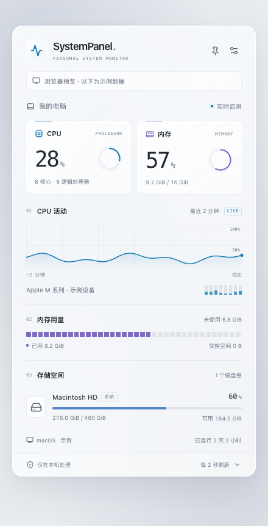

<p align="center">
  
</p>

<h1 align="center">SystemPanel</h1>

<p align="center"><strong>English</strong> · <a href="README.zh-CN.md">简体中文</a></p>

<p align="center">A quiet system monitor for your menu bar. CPU, memory, and storage at a glance.</p>

<p align="center">
  <a href="https://github.com/EvilGenius-dot/SystemPanel/actions/workflows/build.yml"></a>
  
  
  
</p>

<p align="center">
  <a href="#preview">Preview</a> ·
  <a href="#getting-started">Getting started</a> ·
  <a href="#development">Development</a> ·
  <a href="#building-and-distribution">Building and distribution</a> ·
  <a href="#faq">FAQ</a>
</p>

SystemPanel is a local system monitor that lives in the **macOS menu bar or Windows system tray**. Click its pulse icon to open a compact panel with real-time resource usage. Sampling continues in the background when the panel is hidden.

No account, no telemetry, and no remote fonts. System metrics stay on your device. Native glass effects give the panel a dark frosted or light silver finish, with an option to follow your system appearance.

The app interface is currently in **Simplified Chinese**. Documentation is available in English and Chinese.

> **v0.1.0 — initial release.** Local builds and native UI checks have been completed on Apple Silicon macOS. Build workflows are configured for Intel Mac and Windows, but native interaction still needs verification on those devices. Code signing and Apple notarization are not yet configured.

## Preview

<table>
  <tr>
    <th align="center">Dark · Black frosted glass</th>
    <th align="center">Light · Silver frosted glass</th>
  </tr>
  <tr>
    <td></td>
    <td></td>
  </tr>
</table>

These are browser previews with clearly labeled sample data. The desktop app displays real metrics from your device. Native background blur varies with your wallpaper, OS version, and transparency settings.

## Features

| Module | Details |
| --- | --- |
| CPU | Overall usage, processor model, core count, activity per logical processor, and a two-minute history |
| Memory | Used and total memory, unused memory, swap usage, and a segmented usage bar |
| Storage | Used, total, and available space per volume, with the system volume shown first |
| Device | Hostname, OS version, and uptime |
| Appearance | Dark, light, and system themes; native glass material follows the selected theme |
| Refresh | 1, 2, or 5 seconds; defaults to 2 seconds. Disk space refreshes every 15 seconds |
| Window | Single instance, tray toggle, pinning, hide on focus loss, and `Esc` to dismiss |

Theme and refresh preferences are saved locally. This initial version does not include temperature, GPU or network monitoring, a process list, launch at login, or automatic updates.

## Getting started

### Get the app

Build from source, or open a successful run in [GitHub Actions](https://github.com/EvilGenius-dot/SystemPanel/actions/workflows/build.yml) and download the artifact for your platform from the **Artifacts** section. Downloading Actions artifacts generally requires signing in to GitHub.

| Platform | Artifact name | Installer |
| --- | --- | --- |
| Apple Silicon Mac | `SystemPanel-aarch64-apple-darwin` | `.dmg` |
| Intel Mac | `SystemPanel-x86_64-apple-darwin` | `.dmg` |
| Windows x64 | `SystemPanel-x86_64-pc-windows-msvc` | NSIS `.exe` installer |

On macOS, open the `.dmg` and move the app to Applications. On Windows, run the installer. The current workflow uploads build artifacts but does not automatically create GitHub Releases. Unsigned builds may trigger OS security prompts; building from source is recommended while trying this early version.

### Use the panel

| Action | Behavior |
| --- | --- |
| Launch the app | Start in the menu bar or system tray with the panel hidden |
| Left-click the tray icon | Show or hide the panel |
| Right-click the tray icon | Show the panel or quit the app |
| Click the pin | Keep the panel open when it loses focus |
| Press `Esc` or click the hide button | Hide the panel while sampling continues |
| Open settings | Change the theme or refresh interval, or quit the app |
| Launch the app again | Show the existing instance without creating another tray icon |

There is no Dock icon on macOS and no taskbar window on Windows. Windows may place the tray icon in the overflow area. Pinning resets on each launch; `Esc` and the tray icon can still dismiss a pinned panel.

## Development

### Prerequisites

- **Node.js 22.12+** — Node.js 22 LTS is recommended.
- **Rust 1.92+** — the toolchain version verified locally. Both npm and Cargo lockfiles are included.
- **macOS** — install Xcode Command Line Tools. The app targets macOS 11 and later.
- **Windows 10 / 11** — install Visual Studio C++ Build Tools with the **Desktop development with C++** workload, the Rust MSVC toolchain, and Microsoft Edge WebView2 Runtime.

See the [Tauri prerequisites](https://v2.tauri.app/start/prerequisites/) for detailed platform setup.

### Run the desktop app

```bash
git clone https://github.com/EvilGenius-dot/SystemPanel.git
cd SystemPanel
npm ci
npm run desktop
```

Click the pulse icon in the menu bar or system tray after startup. To open the panel immediately when launching the development build:

```bash
npm run desktop -- -- --show
```

### Preview the interface

```bash
npm run dev
```

Open [http://127.0.0.1:1420](http://127.0.0.1:1420). A regular browser cannot access the system collection API, so it displays clearly labeled sample data. If collection fails in the desktop app, the panel shows an error and the last available readings; it never falls back to sample data.

## Building and distribution

Run the appropriate command on the target platform:

```bash
# macOS: create an app bundle and disk image
npm run desktop:build -- --bundles app,dmg

# Windows: create an NSIS installer
npm run desktop:build -- --bundles nsis
```

Default output directory:

```text
src-tauri/target/release/bundle/
├── macos/SystemPanel.app
├── dmg/*.dmg
└── nsis/*.exe
```

Each platform produces only its corresponding directories. When an explicit `--target` is supplied, output goes to `src-tauri/target/<target>/release/bundle/`.

The [build workflow](.github/workflows/build.yml) runs on pushes to `main`, `v*` tags, pull requests, and manual dispatch. It covers Apple Silicon Mac, Intel Mac, and Windows x64, alongside frontend, Rust, and UI checks.

Before public distribution, configure your own application identifier, code signing, and notarization. The current identifier is `dev.systempanel.desktop`. The transparent macOS WebView uses Tauri's `macos-private-api` feature; this configuration is intended for direct desktop distribution, not a Mac App Store build.

## Checks and tests

```bash
npm run check
npm test
npm run build
npm run test:ui

cargo fmt --manifest-path src-tauri/Cargo.toml --check
cargo test --manifest-path src-tauri/Cargo.toml --locked
cargo clippy --manifest-path src-tauri/Cargo.toml --locked -- -D warnings
```

- **Frontend unit tests:** capacity units, percentage bounds, chart timestamps, and uptime formatting.
- **Rust unit tests:** macOS system volume deduplication, capacity bounds, history buffering, and positioning across displays and scale factors.
- **UI tests:** saved theme and refresh settings, narrow layouts, native appearance commands, system theme changes, and connection errors.

Local UI tests use an installed Google Chrome browser. CI uses Playwright Chromium. Temporary screenshots and test output go to `validation/`, which is excluded from Git. README preview images are stored separately in `docs/images/`.

Before releasing on each platform, also check tray interactions, focus loss, pinning, quitting, display scaling, external drive changes, and sleep/wake behavior. A successful CI build does not replace native interaction testing.

## Metrics and privacy

- **Collection:** a Rust background thread reuses `sysinfo::System` and refreshes only the CPU, memory, and disk information it needs. It does not scan processes or file contents.
- **CPU:** usage is calculated from successive samples, so the first reading takes a short moment. History keeps at most 121 points and uses actual timestamps. Long sampling gaps or backward clock changes clear discontinuous history.
- **Capacity:** values use binary KiB / MiB / GiB / TiB units, which differ from decimal GB shown by some system tools.
- **Memory:** figures follow the OS and `sysinfo` accounting model. They are not equivalent to macOS Memory Pressure.
- **Storage:** volumes are displayed individually. On macOS, the Data volume is preferred and duplicate system mounts are filtered out. Capacities of volumes sharing a storage pool are not added together. Available APFS space may differ from Finder's accounting of purgeable space.
- **Privacy:** system metrics stay on your device. Hostnames, volume names, and resource usage are not uploaded. There is no telemetry, and fonts, icons, and charts do not depend on remote services.

Pass `--diagnostics` to the local executable to wait for a CPU sample, print a single JSON snapshot, and exit without opening a window. Diagnostic output contains your hostname and volume names; remove any device information you do not want to publish before attaching it to an issue.

## Project structure

```text
SystemPanel/
├── src/                       # React UI, themes, polling, and formatting
├── src-tauri/
│   ├── src/metrics.rs         # System collection and history buffering
│   ├── src/lib.rs             # IPC, tray, native themes, and window lifecycle
│   ├── src/position.rs        # Panel positioning across displays
│   ├── capabilities/          # Tauri window permissions
│   ├── icons/                 # Application and tray icons
│   └── tauri.conf.json        # Desktop and packaging configuration
├── tests/                     # Playwright UI tests
├── scripts/generate-icons.mjs # Reproducible icon generation
├── docs/images/               # README preview images
├── .github/workflows/         # Checks and platform builds
└── AGENTS.md                  # Product scope and engineering guidelines
```

## FAQ

<details>
<summary>Why is there no window after launch?</summary>

This is intentional. Click the pulse icon in the macOS menu bar or Windows system tray. On Windows, check the tray overflow area if the icon is not immediately visible.

</details>

<details>
<summary>Why do readings differ from the OS monitoring tools?</summary>

Sampling intervals and accounting methods can differ. SystemPanel samples every two seconds by default and uses binary capacity units. macOS Memory Pressure and purgeable disk space also measure different things from the usage figures shown here.

</details>

<details>
<summary>Why is the glass effect subtle?</summary>

The OS renders the desktop glass material. Its appearance depends on the background, OS version, and transparency settings. It is usually subtler over a solid background and may appear opaque when system transparency is disabled. The browser preview does not reproduce native desktop materials exactly.

</details>

<details>
<summary>What if macOS reports that the Xcode license has not been accepted?</summary>

Complete Xcode's first-run setup and review the license yourself. If a working standalone Command Line Tools installation is already available, you can select it for a single command:

```bash
DEVELOPER_DIR=/Library/Developer/CommandLineTools npm run desktop
```

This does not change the global `xcode-select` setting.

</details>

## Feedback and contributions

Use [Issues](https://github.com/EvilGenius-dot/SystemPanel/issues) to report a bug or suggest an improvement. Include your OS version, device architecture, steps to reproduce, and expected behavior. For layout issues, a screenshot with private information removed is helpful.

Before contributing code, read [AGENTS.md](AGENTS.md), run the relevant checks, and state which platforms you actually tested. Native testing feedback from Windows and Intel Mac devices is especially welcome.
