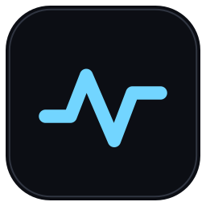
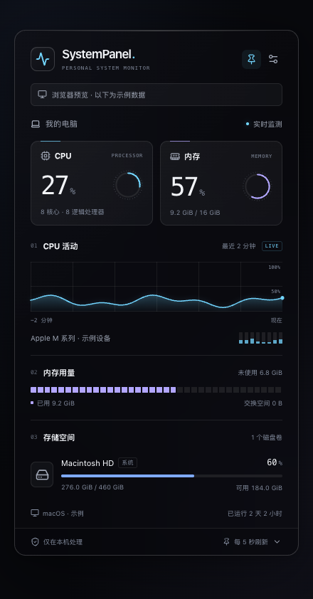
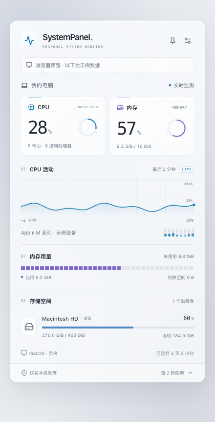

<p align="center">
  
</p>

<h1 align="center">SystemPanel</h1>

<p align="center"><a href="README.md">English</a> · <strong>简体中文</strong></p>

<p align="center">菜单栏里的系统看板。CPU、内存与磁盘状态，抬眼即见。</p>

<p align="center">
  <a href="https://github.com/EvilGenius-dot/SystemPanel/actions/workflows/build.yml"></a>
  
  
  
</p>

<p align="center">
  <a href="#界面预览">界面预览</a> ·
  <a href="#开始使用">开始使用</a> ·
  <a href="#本地开发">本地开发</a> ·
  <a href="#构建与分发">构建与分发</a> ·
  <a href="#常见问题">常见问题</a>
</p>

当前应用界面为简体中文；项目文档提供英文和中文版本。

SystemPanel 是一个常驻 **macOS 菜单栏 / Windows 系统托盘** 的本地系统监控工具。点击脉冲图标即可展开紧凑面板，查看实时资源用量；收起面板后仍在后台采样。

无需登录，无遥测，无远程字体，系统指标只在本机处理。桌面端采用系统原生玻璃材质，提供黑色毛玻璃、银白磨砂玻璃以及跟随系统的外观。

> 当前为 **v0.1.0 初始版本**。Apple Silicon Mac 已完成本地构建和界面实测；Intel Mac 与 Windows 已配置构建流程，仍需对应设备完成原生交互验证。安装包尚未配置代码签名与 Apple 公证。

## 界面预览

<table>
  <tr>
    <th align="center">深色 · 黑色毛玻璃</th>
    <th align="center">浅色 · 银白磨砂玻璃</th>
  </tr>
  <tr>
    <td></td>
    <td></td>
  </tr>
</table>

以上为浏览器界面预览，图中已明确标注示例数据。桌面版显示本机真实指标，背景模糊效果会随桌面背景、系统版本和透明效果设置变化。

## 功能

| 模块 | 内容 |
| --- | --- |
| CPU | 总使用率、处理器型号、核心数、各逻辑处理器活动、最近 2 分钟趋势 |
| 内存 | 已用 / 总量、未使用量、已用交换空间、分段使用率条 |
| 存储 | 按卷显示已用 / 总量与可用空间，优先展示系统卷 |
| 设备 | 主机名、系统版本、开机运行时间 |
| 外观 | 深色、浅色、跟随系统；原生玻璃材质与界面同步切换 |
| 刷新 | 1 / 2 / 5 秒可选，默认 2 秒；磁盘每 15 秒刷新 |
| 窗口 | 单实例、托盘展开 / 收起、固定面板、失焦隐藏、Esc 收起 |

主题与刷新频率自动保存在本地。首版不包含温度、GPU、网络速率、进程列表、开机启动或自动更新。

## 开始使用

### 获取应用

可以从源码构建，或在 [GitHub Actions](https://github.com/EvilGenius-dot/SystemPanel/actions/workflows/build.yml) 中选择一次成功的构建，从页面底部 **Artifacts** 下载对应平台的产物。下载 Actions 产物通常需要登录 GitHub。

| 平台 | 构建产物名称 | 安装文件 |
| --- | --- | --- |
| Apple Silicon Mac | `SystemPanel-aarch64-apple-darwin` | `.dmg` |
| Intel Mac | `SystemPanel-x86_64-apple-darwin` | `.dmg` |
| Windows x64 | `SystemPanel-x86_64-pc-windows-msvc` | NSIS `.exe` 安装包 |

macOS 打开 `.dmg` 后将应用放入「应用程序」；Windows 运行安装包。当前工作流上传构建产物，不自动创建 GitHub Release。未签名版本可能触发操作系统的安全提示，建议先从源码构建体验。

### 面板操作

| 操作 | 行为 |
| --- | --- |
| 启动应用 | 常驻菜单栏 / 系统托盘，默认不展开面板 |
| 左键点击图标 | 展开或收起面板 |
| 右键点击图标 | 显示看板或退出应用 |
| 点击图钉 | 保持面板展开，失焦后仍显示 |
| 按 `Esc`、点击收起按钮 | 隐藏面板，后台继续采样 |
| 点击设置 | 切换主题、调整刷新频率或退出应用 |
| 再次启动应用 | 唤起已有实例，不重复创建托盘图标 |

macOS 不显示 Dock 图标；Windows 不显示任务栏窗口，新图标可能位于托盘折叠区域。固定状态每次启动时复位，固定后仍可用 `Esc` 或托盘图标收起。

## 本地开发

### 环境准备

- **Node.js 22.12+**：推荐使用 Node.js 22 LTS。
- **Rust 1.92+**：本地已验证的工具链版本；仓库包含 npm 与 Cargo 锁文件。
- **macOS**：安装 Xcode Command Line Tools；应用目标系统为 macOS 11+。
- **Windows 10 / 11**：安装 Visual Studio C++ Build Tools 的「使用 C++ 的桌面开发」工作负载、Rust MSVC 工具链及 Microsoft Edge WebView2 Runtime。

详细环境要求可参考 [Tauri 开发环境文档](https://v2.tauri.app/start/prerequisites/)。

### 启动桌面版

```bash
git clone https://github.com/EvilGenius-dot/SystemPanel.git
cd SystemPanel
npm ci
npm run desktop
```

启动后点击菜单栏 / 托盘中的脉冲图标。需要启动时直接展开面板，可运行：

```bash
npm run desktop -- -- --show
```

### 只调试界面

```bash
npm run dev
```

打开 [http://127.0.0.1:1420](http://127.0.0.1:1420)。普通浏览器无法访问系统采集接口，因此显示带有明确标识的示例数据。桌面模式采集失败时会显示错误与上次采集结果，不会回退到示例数据。

## 构建与分发

在对应平台运行：

```bash
# macOS：生成应用与磁盘映像
npm run desktop:build -- --bundles app,dmg

# Windows：生成 NSIS 安装包
npm run desktop:build -- --bundles nsis
```

默认输出目录：

```text
src-tauri/target/release/bundle/
├── macos/SystemPanel.app
├── dmg/*.dmg
└── nsis/*.exe
```

各平台仅生成对应的子目录。显式传入 `--target` 时，产物位于 `src-tauri/target/<target>/release/bundle/`。

[构建工作流](.github/workflows/build.yml) 在推送 `main`、推送 `v*` 标签、提交 Pull Request 或手动触发时执行，覆盖 Apple Silicon Mac、Intel Mac 和 Windows x64，并运行前端、Rust 与界面检查。

正式分发前需要配置自己的应用标识、代码签名与公证。当前标识为 `dev.systempanel.desktop`；macOS 透明 WebView 使用 Tauri 的 `macos-private-api`，按独立桌面应用分发设计，不作为 Mac App Store 构建。

## 检查与测试

```bash
npm run check
npm test
npm run build
npm run test:ui

cargo fmt --manifest-path src-tauri/Cargo.toml --check
cargo test --manifest-path src-tauri/Cargo.toml --locked
cargo clippy --manifest-path src-tauri/Cargo.toml --locked -- -D warnings
```

- **前端单元测试**：容量单位、百分比边界、趋势时间轴、运行时间格式化。
- **Rust 单元测试**：macOS 系统卷去重、容量边界、趋势缓冲、多显示器与高 DPI 定位。
- **界面测试**：主题与刷新设置持久化、窄窗口布局、原生外观命令、跟随系统与连接失败提示。

本地界面测试使用已安装的 Google Chrome；CI 使用 Playwright Chromium。临时截图和测试输出写入 `validation/`，不提交到仓库。README 使用的预览图单独存放在 `docs/images/`。

每个平台发布前还应实测托盘点击、失焦隐藏、固定面板、退出、不同屏幕缩放、外接磁盘插拔及休眠唤醒。CI 编译通过不能代替原生交互验收。

## 数据与隐私

- **采集方式**：Rust 后台线程复用 `sysinfo::System`，只刷新需要的 CPU、内存与磁盘指标，不扫描进程或文件内容。
- **CPU**：使用前后两次采样计算使用率，首次采样需短暂等待；趋势最多保留 121 个点，按真实时间绘制，长时间采样间断或时钟回退后清空不连续历史。
- **容量**：统一采用 KiB / MiB / GiB / TiB 二进制单位，与部分系统界面的十进制 GB 会有差异。
- **内存**：采用操作系统与 `sysinfo` 的统计口径，不等同于 macOS「内存压力」。
- **磁盘**：按挂载卷展示，macOS 优先读取 Data 卷并过滤重复系统挂载；不会把共享存储池的卷容量相加。APFS 可用空间与 Finder 的「可清除空间」口径可能不同。
- **隐私**：系统指标只在本机处理，不上传主机名、卷名或资源用量，不接入遥测；字体、图标与图表不依赖远端服务。

可对本地可执行文件传入 `--diagnostics`，等待一次 CPU 采样后输出单次 JSON 并退出，不启动窗口。诊断结果含主机名和卷名，在反馈问题时请先检查并移除不想公开的设备信息。

## 项目结构

```text
SystemPanel/
├── src/                       # React 界面、主题、数据轮询与格式化
├── src-tauri/
│   ├── src/metrics.rs         # 系统采集与趋势缓冲
│   ├── src/lib.rs             # IPC、托盘、原生主题与窗口生命周期
│   ├── src/position.rs        # 多显示器弹出位置计算
│   ├── capabilities/          # Tauri 窗口权限
│   ├── icons/                 # 应用与托盘图标
│   └── tauri.conf.json        # 桌面与打包配置
├── tests/                     # Playwright 界面测试
├── scripts/generate-icons.mjs # 可重复生成图标
├── docs/images/               # 项目首页预览图
├── .github/workflows/         # 检查与跨平台构建
└── AGENTS.md                  # 产品边界与工程协作约定
```

## 常见问题

<details>
<summary>启动后没有窗口？</summary>

这是默认行为。请点击 macOS 菜单栏或 Windows 系统托盘中的脉冲图标。Windows 上可先查看托盘的折叠区域。

</details>

<details>
<summary>为什么数据与系统自带监控工具不完全一样？</summary>

不同工具的采样周期和统计口径可能不同。SystemPanel 默认每 2 秒采样，容量使用二进制单位；macOS 内存压力、磁盘可清除空间也不等同于本面板展示的使用量。

</details>

<details>
<summary>为什么背景模糊不明显？</summary>

桌面版的玻璃材质由操作系统渲染，效果受背景、系统版本及透明效果设置影响。在纯色背景下通常更含蓄；关闭系统透明效果时可能表现为实色。浏览器预览不等同于原生桌面材质。

</details>

<details>
<summary>macOS 编译提示尚未确认 Xcode 许可？</summary>

请由本人完成 Xcode 的首次初始化与许可确认。如果已经安装可用的独立 Command Line Tools，也可以仅对当前命令指定工具链：

```bash
DEVELOPER_DIR=/Library/Developer/CommandLineTools npm run desktop
```

这不会修改全局 `xcode-select` 设置。

</details>

## 反馈与贡献

欢迎通过 [Issues](https://github.com/EvilGenius-dot/SystemPanel/issues) 提交问题或建议。请附上操作系统版本、设备架构、复现步骤及预期行为；涉及布局时可提供已移除隐私信息的截图。

提交代码前请阅读 [AGENTS.md](AGENTS.md)，运行相关检查，并注明实际验证的平台。尤其欢迎补充 Windows 与 Intel Mac 的实机反馈。
